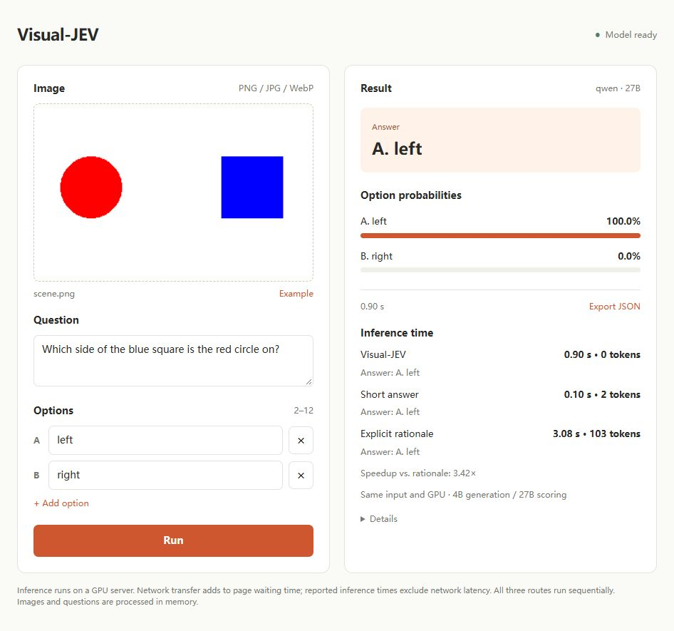

# Interactive demo

Upload or drag an image, enter a question, add 2–12 text options and click
**Run**. The page displays the selected answer and each option's probability.
**Export JSON** saves raw scores, probabilities, model identity and timings.
**Details** shows the same information in the browser.

## Install and start

Run from the repository root on Linux or WSL with Python 3.12 and a
CUDA-compatible PyTorch/torchvision installation. The full BF16 runtime was
tested on **one 80 GB NVIDIA H100**. CPU, quantized and offloaded inference
are not implemented in this demo.

```bash
git clone https://github.com/staryzj/jev_visual.git
cd jev_visual
python -m venv .venv
source .venv/bin/activate
python -m pip install -e '.[transfer]'
python -m visualjev.assets --destination ./assets --assets base27 openjev27 qwen4 interfaces
python -m visualjev.demo --assets ./assets --encoder qwen --port 7860
```

Open **http://127.0.0.1:7860**. Wait for **Model ready**, then use **Example**
or your own image. Questions and options can be edited freely.

The downloader retrieves the pinned receiver, source model and four selected
interface checkpoints, and checks file hashes. Full pretrained weights require
substantial disk space; exact files and sizes are in
[`visual_jev_assets.lock.json`](../release_metadata/visual_jev_assets.lock.json).
The interface weights are distributed through the existing
[model release](https://github.com/staryzj/jev_visual/releases/tag/visual-jev-v0.2.0).
Existing verified assets can be reused with `--assets /path/to/assets` or
`VISUAL_JEV_ASSETS=/path/to/assets`.

For the exact experiment dependency versions, install `'.[transfer,reproduce]'`
instead of `'.[transfer]'`; see the
[paper runtime guide](FROZEN_RECEIVER_RELEASE.md) for the complete environment.

## Remote GPU

Start the same command on a GPU server. On your laptop, run:

```bash
ssh -N -L 7860:127.0.0.1:7860 user@gpu-host
```

Then open **http://127.0.0.1:7860** on the laptop. The service binds to
loopback by default. For public hosting, place it behind an authenticated
reverse proxy; this demo does not provide accounts or public-access controls.
Stop the GPU process with Ctrl+C when finished.

## Other encoders

Download the additional source asset (`llava`, `internvl` or `siglip2`), then
restart with the matching `--encoder`. For example:

```bash
python -m visualjev.assets --destination ./assets --assets siglip2
python -m visualjev.demo --assets ./assets --encoder siglip2
```

One encoder and the same frozen receiver are loaded per service. Use
`CUDA_VISIBLE_DEVICES=0` to choose the GPU before starting.

## Test and interpret results

```bash
python -m unittest discover -s tests -p test_demo_inputs.py -v
```

The CPU tests check uploaded pixels, option order and input validation.
[Live verification](../reports/demo/live_verification.json) separately records
real GPU inference: five paper cases and one CLI scene match their archived
candidate scores exactly, and one additional custom three-option question runs
successfully. The same frozen-receiver runtime, selected interface checkpoints,
candidate templates and BF16 math-attention settings are used for live requests.

- PNG, JPEG and WebP images: up to 16 MB and 24 megapixels.
- Options are text; image-choice composite canvases must be prepared separately.
- The original 2,048-token model limit is enforced without silent truncation.
- Probabilities are softmax over the supplied options at T=1. Changing options
  changes the distribution; these values are not calibrated correctness estimates.
- Timing includes visual encoding, prompt preparation, bridging and candidate
  scoring. Upload, image decoding and initial model loading are excluded.
  First requests may include warm-up, so these times are separate from the
  paper's matched benchmark timings.
- Concurrent requests receive a busy response. Submitted images and questions
  are processed in memory and are not saved by the application.

Model provenance and licenses are listed in
[third-party notices](../THIRD_PARTY_NOTICES.md).

## Live timing comparison (Qwen)

The Qwen service also loads the original full Qwen3-VL 4B model on the same
GPU. Each request runs Visual-JEV, native short-answer generation (64-token
cap), and native explicit-rationale generation (1,024-token cap) sequentially.
Both native prompts, generated text, token counts and cap status are exported.
Two-token generation warm-ups run during startup. All routes use BF16 math
SDPA and the same source pixel policy. Timing includes prompt preparation and
model computation; upload, image decoding and model loading are excluded.
The native model has 4B parameters; the JEV receiver has 27B. These are single
request timings, not paper benchmark averages. Short answers may be faster
than JEV; speedup is reported as measured, even when below 1. Other encoders
currently display JEV results only. Extra memory is needed for the full 4B
model; the combined Qwen runtime is tested on an 80 GB H100.

The comparison shows the option selected by each route. Native answers are parsed from the final Answer: letter, or a direct short-answer letter; ambiguous outputs are marked and retained in Details. GPU-server network transfer adds to browser waiting time, while reported inference times exclude network latency. All three routes run sequentially, so page waiting time includes their combined execution.


